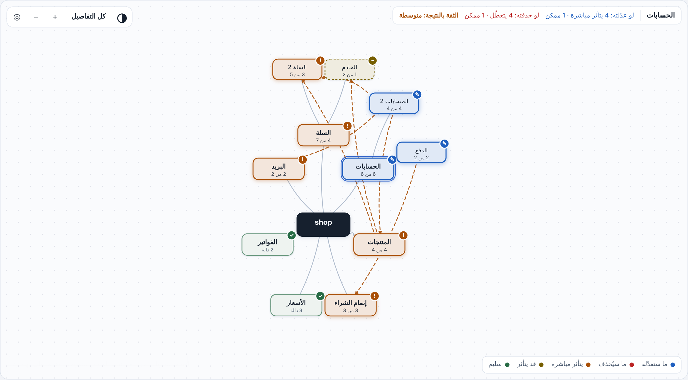

# خريطة الأثر · Impact Map

**[English](README.md)** · العربية

   

<p align="center"></p>

*مشروع تجريبي صغير. الأزرق: الجزء المختار. البرتقالي: يتأثر مباشرة. الأصفر المتقطع: قد يتأثر. الأخضر: سليم.*

<p align="center"><a href="docs/demo.mp4"><b>▶ شاهد العرض (55 ثانية، بالصوت، بالإنكليزي)</b></a></p>

<p align="center"></p>

**شو هي؟** أداة بتقرأ كود مشروعك (JavaScript / TypeScript / React / HTML) وبتطلّعلك صفحة وحدة فيها خريطتين:

1. **خريطة المشروع:** أجزاء مشروعك وكيف مرتبطة ببعض. اضغط على أي جزء، وتحت الخريطة بتشوف جنب بعض **«لو عدّلته»** و**«لو حذفته»**: شو رح يتأثر **قبل** ما تلمس شي. زر **«كل التفاصيل»** بيعرض كل دالة بالمشروع كمربع لحالها.
2. **خريطة الصلاحيات:** (بستايل الهاكر) الصلاحيات الدائمة اللي سمحت فيها لـ Claude Code، وشو تفرّع عن كل وحدة، وأي أجزاء من مشروعك بتتأثر.

كل شي بيشتغل على جهازك. ما بيتصل بالإنترنت وما بيرفع شي لأي مكان.

## البداية السريعة: خلّي Claude يستعين بالخريطة كل مرة

**1. التثبيت** (مرة وحدة). داخل Claude Code:

```
/plugin marketplace add waleedolabs/impact-map
```

ابعتهم **واحد واحد**: `/plugin` بيقبل سطراً واحداً بكل رسالة، فلو لصقت الأمرين مع بعض بيطلع خطأ «/plugin only works on a single line». استنّى الأول يخلص وبعدين ابعت التاني. (أو شغّلهم بالطرفية: `claude plugin marketplace add waleedolabs/impact-map` و`claude plugin install impact-map@impact-map`.)

```
/plugin install impact-map@impact-map
```

وبعدها افتح **جلسة جديدة** (الإضافة بتنقرا لما تبلّش الجلسة).

**2. فعّلها بمشروعك.** داخل مشروعك شغّل:

```
/impact-map-keep
```

بيضيف قاعدة دائمة لملف `CLAUDE.md` بمشروعك (بتشوفها وبتقدر تشيلها بـ `/impact-map-keep off`)، فبتنطبق على كل الجلسات الجاية بدون ما تعيد شي.

وإذا بتفضّل تحكي الجملة بنفسك، قلها لـ Claude مرة وحدة:

> **«استعن بخريطة الأثر في كل خطوة: قبل ما تعدّل أو تحذف أي شي شوف مين بيعتمد عليه وقلي مستوى الثقة، ولا تحذف شي مرتبط قبل ما أوافق، وبعد ما تخلّص حدّث الخريطة.»**

**3. شو بيصير بعدها:**

- **قبل أي تعديل أو حذف** بيسأل الخريطة وبيقلك بجملة أو جملتين مين بيعتمد على اللي رح يلمسه، ومستوى الثقة.
- **إذا في شي بيعتمد عليه** بيحدّثه بنفس التعديل أو بينبّهك، وما بيحذف شي مرتبط (أو ثقته متوسطة/منخفضة) قبل ما توافق.
- **بعد ما يخلّص دفعة تعديلات** بيعيد بناء الخريطة فبتبقى مطابقة للكود، وبيشغّل الاختبارات.

**4. تأكد إنها شغّالة.** افتح `CLAUDE.md` وشوف الكتلة بين `<!-- impact-map:start -->` و`<!-- impact-map:end -->`. بعدين اطلب من Claude يحذف دالة بيستعملها كود تاني: لازم يسأل الخريطة أول ويذكر مستوى الثقة.

**شي لازم تعرفه:**

- هاي تعليمات بيتبعها Claude، مو برنامج شغّال بالخلفية: الخريطة بتتحدّث لما Claude ينفّذ القاعدة (بعد كل دفعة تعديلات)، مو مع كل حرف.
- الخريطة بتساعده يقرر وما بتغني عن تشغيل الكود. ثقة متوسطة أو منخفضة يعني «روح شوف الملفات المذكورة بالسبب».
- **ما انجرّبت بجلسة Claude Code حية بعد.** جرّبها على مشروع صغير أول مرة، وإذا Claude تجاهل القاعدة ذكّره بالجملة فوق و[بلّغنا](https://github.com/waleedolabs/impact-map/issues).

## الاستخدام داخل Claude Code (الأسهل)

ركّبها كإضافة مرة وحدة، وبعدها احكي مع Claude بشكل عادي:

```
/plugin marketplace add waleedolabs/impact-map
```

ابعتهم **واحد واحد**: `/plugin` بيقبل سطراً واحداً بكل رسالة، فلو لصقت الأمرين مع بعض بيطلع خطأ «/plugin only works on a single line». استنّى الأول يخلص وبعدين ابعت التاني. (أو شغّلهم بالطرفية: `claude plugin marketplace add waleedolabs/impact-map` و`claude plugin install impact-map@impact-map`.)

```
/plugin install impact-map@impact-map
```

(إذا المستودع خاص، لازم يكون حسابك على GitHub مسجّل دخول بجهازك. أو نزّله وضيفه من مجلد محلي:
`/plugin marketplace add المسار-المحلي`.)

بعدها:

- اكتب **`/impact-map`** ← بيبني الصفحة ويقلك وين الملف وكيف تفتحه.
- أو احكي: **«شو بيتأثر لو حذفت ملف accounts.js؟»** ← Claude بيقرأ الخريطة ويجاوبك بكلام بسيط.
- أو: **«شو الصلاحيات اللي سمحتلك فيها بهالمشروع؟»**

الصفحة بتنحفظ بـ`.impact/` جوا مشروعك (أضفه لـ`.gitignore`). Claude بيقرأ بس، وما بيعدّل كودك.

## التشغيل بدون Claude (سطر أوامر)

بدك Node.js 18 أو أحدث. ما في شي تنزّله.

```
node impact.js مسار-مجلد-مشروعك
```

بيطلع ملف `impact-map.html`، افتحه بأي متصفح. خيارات:

| الخيار | شو بيعمل |
|---|---|
| `--out ملف.html` | مكان الملف الناتج |
| `--name "اسم"` | الاسم اللي بيظهر بالصفحة |
| `--names names.json` | أسماء الأجزاء اللي بدك ياها (بدل التلقائية) |
| `--user-settings ملف.json` | نسخة من إعدادات Claude Code الشخصية (لازم تعطيني نسخة بنفسك) |
| `--lang ar` أو `en` أو `auto` | لغة الصفحة وكلام الأداة (الافتراضي `auto`: عربي إذا جهازك عربي، وإلا إنكليزي) |
| `--json graph.json` | حفظ الخريطة الخام |

بالصفحة نفسها:

- **«كل التفاصيل» / «ملخّص»**: كل دالة كمربع، أو الأجزاء بس.
- **عجلة الماوس** للتقريب، و**السحب** لتحريك الخريطة، و◎ لترجيعها.
- زر **الوضع الفاتح / الداكن**.
- **«غيّر الاسم»** لأي جزء، والاسم بينحفظ بمتصفحك.

## التحديث

لما تنزل نسخة جديدة:

```
claude plugin marketplace update impact-map
claude plugin update impact-map@impact-map
```

وبعدها افتح **جلسة جديدة** بـ Claude Code (الإضافة بتنقرا لما تبلّش الجلسة).

## مؤشر الثقة

جنب كل نتيجة بتشوف **الثقة: عالية / متوسطة / منخفضة**، ومعها السبب بكلام بسيط. المؤشر ما بيغيّر النتيجة، بس بيقلك **إيمتى تصدّق الخريطة وإيمتى تتأكد بنفسك**:

- **عالية:** كل الروابط لهالجزء مكتوبة صراحة بالكود (استدعاء أو استيراد مباشر).
- **متوسطة:** في شي حواليه الخريطة ما بتقدر تتبعه بالكامل، مثلاً ملف بيذكر ملفه أو مجلده بالاسم (بيقراه كبيانات أو بيشغّله)، أو بيوصل لدواله بأسماء بتنحسب وقت التشغيل (`obj[name]`)، أو بيتمرّر كدالة رد.
- **منخفضة:** الخريطة بتقول «ما حدا بيستعمله»، بس في كود بنفس المكان بيحمّل ملفات بأسماء ما بتنعرف قبل التشغيل. هون لا تحذف قبل ما تتأكد.

جرّبناه على الحالات اللي الخريطة فعلياً غلطت فيها: التسع ملفات اللي فاتت الخريطة بكود هالأداة طلعت كلها «متوسطة» مع السبب الصح. وبمشروع express، الملف الوحيد اللي بيتحمّل بـ `require(path)` (ما حدا بيستورده صراحة) طلع «منخفضة».

## قد إيش هي دقيقة؟ (أرقام حقيقية، مع حدودها)

- **الروابط بين الملفات:** على مشروع صغير بـ14 ملف، حذفنا كل ملف فعلياً وشغّلنا الباقي: انكسر 49 ملف، والخريطة ما فاتها ولا واحد. وعلى كود هالأداة نفسها (36 ملف): انكسر 90 ملف، والخريطة توقّعت 81 (90%). **التسعة اللي فاتتها كلها نفس الحالة:** ملف اختبار بيقرا مشروعاً تانياً **كبيانات** مو ككود، وهالنوع من الاعتماد ما بيبيّن بالخريطة. (بيقيس الكسر عند تحميل الملف بس؛ `tests/file_level_check.js` بيعيد القياس على أي مشروع.)
- **الروابط بين الدوال:** على لعبة حقيقية (112 دالة)، حذفنا 90 دالة وشغّلنا اللعبة بعد كل حذف. 62 حذف طلّع خطأ واضح، وكل أماكن الخطأ (77) كانت بدوال الخريطة متوقعتها. **28 حذف ما طلّع أي خطأ** (الخطأ بينبلع بصمت)، والخريطة بتبقى بتعرض مين بيعتمد عليها. طريقة العدّ انعدّلت بعد ما شفنا النتائج، فالرقم استرشادي.
- **TypeScript وReact:** على مشروع React/TypeScript حقيقي (11 دالة، 6 روابط)، الروابط طابقت الاستيراد الفعلي (راجعناها بالقراءة).
- **التقسيم التلقائي لأجزاء:** بيطابق تقسيماً يدوياً كتبناه للعبة بنسبة 0.63 من 1 (التقسيم حسب الملفات بس بيعطي 0.23). **الأسماء التلقائية بتطلع أحياناً رديئة**، وهاد سبب وجود زر «غيّر الاسم».
- **تصنيف خطر الصلاحيات:** على 70 صلاحية كتبها وكيل مستقل وحكم عليها وكيلين مستقلين، الأداة لقطت 33 من 39 صلاحية خطرة بأول مرة، و37 بعد تصحيحات عامة (على نفس الأمثلة، فمو اختبار مستقل).

## القيود (اقرأها)

- **اللغات:** JavaScript وTypeScript (بشرط حزمة `typescript` بالمشروع) وReact وHTML. Python وJava وKotlin وغيرها لسا لا.
- **الخريطة تقدير مبني على قراءة الكود، مو ضمان.** الكود اللي بيتحمّل بطريقة ديناميكية أو بأسماء متغيرة ممكن تفوتنا روابطه، والصفحة بتنبّه لما بتلاحظ هيك.
- **الصلاحيات:** الأداة بتشوف **الصلاحيات الدائمة** المحفوظة بملفات إعدادات Claude Code بس (`.claude/settings.json` و`settings.local.json`). الموافقات اللي بتضغط عليها «نعم» مرة وحدة **ما بتنحفظ**، فما بنشوفها. وملف إعداداتك الشخصي العام محمي من Claude نفسه: انسخه بإيدك وأعطيه لـ `--user-settings` إذا بدك.
- **ما انجرّب مع ناس حقيقيين بعد.** لا نعرف إذا الصفحة بتخلّي الشخص العادي يفهم أكتر.
- **الاعتماد عن طريق البيانات** (ملف بيقرا ملف تاني كنص أو JSON، أو بيشغّله كأمر) ما بيبيّن.
- **«ما في شي بيعتمد عليه» ما بتعني «آمن تحذفه».** شغّل اختباراتك دايماً.
- **الحجم:** جرّبناها على مشروع بـ1200 ملف و4800 دالة: الخريطة بتطلع بحوالي 5 ثواني، و«كل التفاصيل» بتفتح بأقل من ثانيتين. أكتر من 1500 ملف بتنقطع، والصفحة بتبيّن هالشي.

## تجريبي: الحارس

`hook/permission_hook.js` سكربت بيصنّف أوامر Claude Code قبل تنفيذها (آمن / بحذر / خطر) وبيسأل بجملة بسيطة. **تجريبي**: ما اتجرّب جوا جلسة Claude Code حقيقية، وبينشر منه تصنيف الصلاحيات المستعمل هون. التفاصيل والأرقام بـ`research/`.

## مساهمة وبلاغات

ملاحظاتك أهم شي بهالمرحلة، خصوصاً: **مشروع الأداة غلطت فيه** (قالت «ما حدا بيعتمد عليه» وانكسر شي). افتح Issue وحط اسم الملف وشو انكسر. التفاصيل بـ `CONTRIBUTING.md`.

## بالتطوير

```
node tests/selftest.js
```

المحلّلات الجاهزة (acorn وacorn-jsx، ترخيص MIT) موجودة بمجلد `vendor/` عشان ما تحتاج تنزّل شي.

---

## English summary

Impact Map reads a JavaScript / TypeScript / React / HTML project and builds one self-contained HTML page with two maps:
(1) a map of the project's parts and what depends on what, with an edit / delete preview before you touch anything;
(2) a map of the standing permissions you gave Claude Code, what branches from each, and which parts of your project they reach.
Everything runs locally. No network, nothing uploaded.

Inside Claude Code (as a plugin): `/plugin marketplace add waleedolabs/impact-map`, then `/plugin install impact-map@impact-map`.
To make Claude use the map on every change, say once: "use the impact map at every step: before you edit or delete anything, check who depends on it and tell me the confidence, and refresh the map when you finish", or run `/impact-map-keep` (adds a standing rule to the project's `CLAUDE.md`; `/impact-map-keep off` removes it). Claude then checks the map before risky edits, will not delete anything others depend on (or with medium/low confidence) without your confirmation, and rebuilds the map afterwards. This mode is instructions that Claude follows; it has not been tested in a live Claude Code session yet.

Then run `/impact-map`, or just ask "what breaks if I delete accounts.js?" and Claude answers from the map.
Update later with `claude plugin marketplace update impact-map` and `claude plugin update impact-map@impact-map`, then start a new session.

Every result carries a confidence level (high / medium / low) with plain reasons: it flags what the map cannot follow around that part (files named in the code and read as data or run, `obj[name]` access, callbacks, code loaded by a run-time name). On real misses it flagged all 9 files the map missed in this tool's own code, and the one express file loaded through `require(path)`.

In the page: pick any part and see "if you edit it" and "if you delete it" side by side under the map; "all details" shows every function as its own box; zoom with the wheel, drag to move, light/dark toggle.

Without Claude:

```
node impact.js path/to/your/project      # writes impact-map.html
```

Honest limits: JS/TS only; the map is an estimate from reading the code, not a guarantee; only *standing* permissions saved in Claude Code settings files are visible (one-time "Yes" clicks are not stored);
dependencies through data (a file reading another as text/JSON, or running it as a command) are not seen; "nothing depends on it" does not mean "safe to delete";
automatic part names are often rough (rename them in the page); not tested with real users yet.
Measured: deleting each file of this tool's own code for real broke 90 files, the map predicted 81 (all 9 misses were a test reading a sample project as data). Tested up to 1200 files / 4800 functions (about 5 s to build). Numbers above are from our own tests and were partly tuned on the same data.

## License

MIT (see LICENSE). Bundled parsers: acorn and acorn-jsx, MIT, in `vendor/`.
