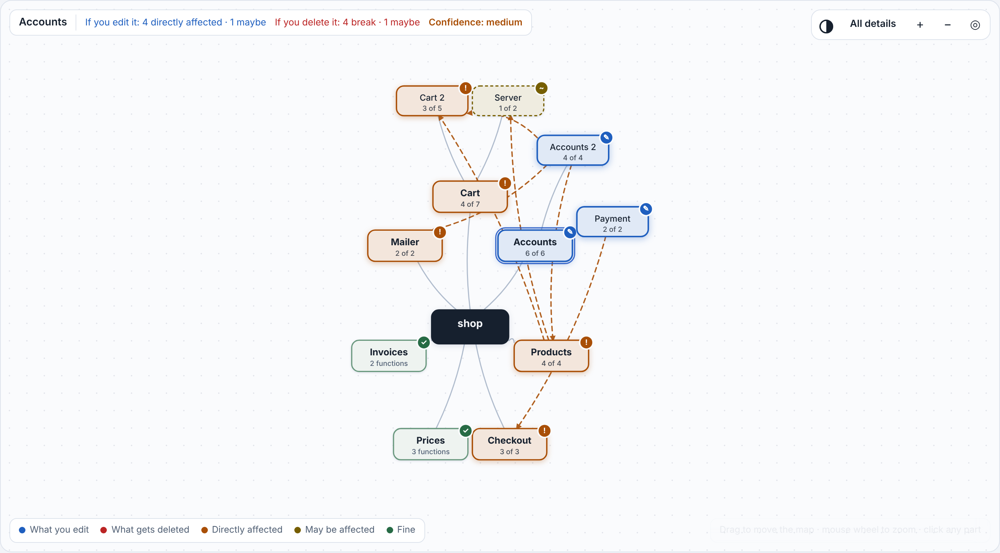
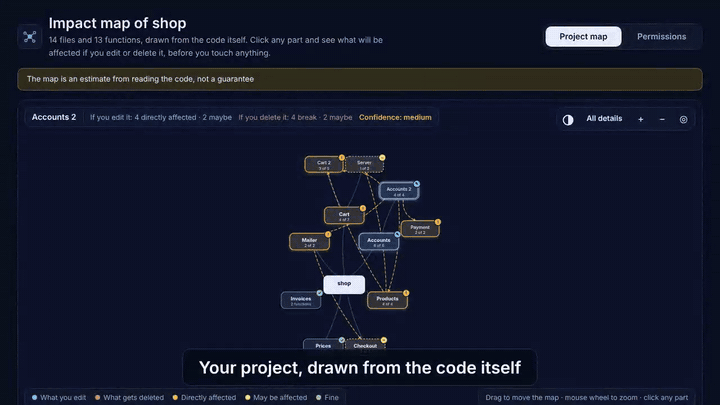

# Impact Map · خريطة الأثر

**English** · **[العربية](README.ar.md)**

   

<p align="center"></p>

*A small demo project. Blue: the part you picked. Orange: directly affected. Dashed yellow: may be affected. Green: fine. The page also comes in Arabic (`--lang ar`).*

<p align="center"><a href="docs/demo.mp4"><b>▶ Watch the 55-second demo with sound</b></a></p>

<p align="center"></p>

**What is it?** A tool that reads your JavaScript / TypeScript / React / HTML project and builds one page with two maps:

1. **Project map:** your project's parts and how they connect. Click any part and, under the map, see side by side **"If you edit it"** and **"If you delete it"**: what will be affected **before** you touch anything. The **All details** button shows every function as its own box.
2. **Permissions map** (hacker style): the standing permissions you gave Claude Code, what branches from each, and which parts of your project they reach.

Everything runs on your computer. It does not connect to the internet and uploads nothing.

## Quick start: make Claude use the map on every change

**1. Install** (once). In Claude Code:

```
/plugin marketplace add waleedolabs/impact-map
/plugin install impact-map@impact-map
```

Then open a **new session** (plugins are read when a session starts).

**2. Turn it on in your project.** Inside your project, run:

```
/impact-map-keep
```

It adds a standing rule to your project's `CLAUDE.md` (you can read it, and remove it with `/impact-map-keep off`), so it applies to every future session without you repeating anything.

Prefer to just say it? Tell Claude once:

> **"Use the impact map at every step: before you edit or delete anything, check who depends on it and tell me the confidence level, don't delete anything others depend on until I agree, and refresh the map when you finish."**

**3. What happens from then on:**

- **Before any edit or delete** Claude asks the map and tells you in a sentence or two who depends on what it is about to touch, and the confidence level.
- **If something depends on it**, Claude updates that in the same change or warns you. It will not delete anything that others depend on (or with medium/low confidence) before you agree.
- **When it finishes** a batch of changes, it rebuilds the map so the page matches the code, and runs the tests.

**4. Check that it works.** Open `CLAUDE.md` and look for the block between `<!-- impact-map:start -->` and `<!-- impact-map:end -->`. Then ask Claude to delete a function that other code uses: it should check the map first and mention the confidence level.

**Good to know:**

- This is a standing instruction that Claude follows, not a background program: the map is refreshed when Claude carries out the rule (after each batch of changes), not on every keystroke.
- The map helps Claude decide; it does not replace running the code. Medium/low confidence means "go and look at the files named in the reason".
- It has **not been tested in a live Claude Code session yet.** Try it on a small project first, and if Claude ignores the rule, remind it with the sentence above and [tell us](https://github.com/waleedolabs/impact-map/issues).

## Use it inside Claude Code (easiest)

Install it once as a plugin, then just talk to Claude:

```
/plugin marketplace add waleedolabs/impact-map
/plugin install impact-map@impact-map
```

(Or from a terminal: `claude plugin marketplace add waleedolabs/impact-map` and `claude plugin install impact-map@impact-map`.)

Then:

- Type **`/impact-map`**: it builds the page and tells you where the file is and how to open it.
- Or ask: **"What happens if I delete accounts.js?"** Claude reads the map and answers in plain words, including the confidence level.
- Or: **"What permissions did I give you in this project?"**

The page is saved in `.impact/` inside your project (add it to `.gitignore`). Claude only reads; it does not change your code. Claude passes `--lang` to match the language you talk to it in.

## Run it without Claude (command line)

You need Node.js 18 or newer. There is nothing to download.

```
node impact.js path-to-your-project
```

It writes `impact-map.html`; open it in any browser. Options:

| Option | What it does |
|---|---|
| `--out file.html` | where to write the page |
| `--lang ar` / `en` / `auto` | language of the page and of what the tool prints (default `auto`: Arabic on an Arabic computer, otherwise English) |
| `--name "Name"` | the name shown on the page |
| `--names names.json` | your own names for the parts (instead of the automatic ones) |
| `--user-settings file.json` | a copy of your personal Claude Code settings (you have to give it a copy yourself) |
| `--json graph.json` | also save the raw map |

In the page itself:

- **All details / Summary:** every function as a box, or the parts only.
- **Mouse wheel** to zoom, **drag** to move the map, ◎ to reset.
- A **light / dark** button.
- **Rename** on any part; the name is saved in your browser.

## Updating

When a new version is out:

```
claude plugin marketplace update impact-map
claude plugin update impact-map@impact-map
```

Then start a **new session** in Claude Code (plugins are read when a session starts).

## Confidence level

Next to every result you see **Confidence: high / medium / low**, with the reason in plain words. It does not change the result; it tells you **when to trust the map and when to check yourself**:

- **High:** every link to this part is written out in the code (direct calls or imports).
- **Medium:** something around it that the map cannot fully follow: for example a file that names this file or its folder (reads it as data, or runs it), reaches its functions by names worked out at run time (`obj[name]`), or it is passed around as a callback.
- **Low:** the map says "nothing uses it", but code in the same place loads files by names that are not known before running. Do not delete before you check.

We tried it on the cases where the map really was wrong: the 9 files it missed in this tool's own code were all marked "medium" with the right reason. In the express project, the one file loaded through `require(path)` (nobody imports it explicitly) was marked "low".

## How accurate is it? (real numbers, with their limits)

- **Links between files:** on a small project of 14 files we deleted each file for real and ran the rest: 49 files broke and the map missed none. On this tool's own code (36 files): 90 files broke and the map predicted 81 (90%). **All 9 it missed are the same case:** a test that reads another project as *data*, not as code; that kind of dependency does not show in the map. (It measures breakage at load time only; `tests/file_level_check.js` repeats the measurement on any project.)
- **Links between functions:** on a real game (112 functions) we deleted 90 functions and ran the game after each deletion. 62 deletions gave a clear error, and all the error places (77) were functions the map had predicted. **28 deletions gave no error at all** (the error is swallowed silently), and the map still shows who depends on them. The counting method was adjusted after we saw the results, so treat the number as a guide.
- **TypeScript and React:** on a real React/TypeScript project (11 functions, 6 links) the links matched the actual imports (checked by reading).
- **Automatic grouping into parts:** it matches a hand-written grouping of the game at 0.63 out of 1 (grouping by files alone gives 0.23). **Automatic names are sometimes poor**, which is why there is a Rename button.
- **Permission risk rating:** on 70 permissions written by an independent agent and judged by two independent agents, the tool caught 33 of 39 dangerous permissions at first, and 37 after general fixes (on the same examples, so it is not an independent test).

## Limits (please read)

- **Languages:** JavaScript, TypeScript (needs the `typescript` package in the project), React and HTML. Python, Java, Kotlin and others: not yet.
- **The map is an estimate from reading the code, not a guarantee.** Code loaded dynamically or by changing names may be missed; the page warns you when it notices.
- **Dependencies through data** (a file reading another file as text or JSON, or running it as a command) are not shown as links; the confidence level flags them.
- **"Nothing depends on it" does not mean "safe to delete".** Always run your tests.
- **Permissions:** the tool sees only the **standing permissions** saved in Claude Code settings files (`.claude/settings.json` and `settings.local.json`). One-time "Yes" approvals are **not saved**, so we cannot see them. Your personal global settings file is protected from Claude itself: copy it yourself and give it to `--user-settings` if you want it included.
- **Size:** we tried a project with 1200 files and 4800 functions: the map is built in about 5 seconds and "All details" opens in under 2. Over 1500 files it is cut, and the page says so.
- **Not tested with real people yet.** We do not know whether the page helps an ordinary person understand more.

## Experimental: the guard

`hook/permission_hook.js` is a script that classifies Claude Code commands before they run (safe / careful / dangerous) and asks with a simple sentence. **Experimental:** it has not been tested inside a live Claude Code session. Set `IMPACT_LANG=en` for English reasons. Details and numbers are in `research/`.

## Contributing and reports

Your feedback matters most at this stage, especially: **the tool was wrong** (it said "nothing depends on it" and something broke). Open an issue with the file name and what broke. Details in `CONTRIBUTING.md`.

## Development

```
node tests/selftest.js
```

The bundled parsers (acorn and acorn-jsx, MIT) are in `vendor/`, so there is nothing to download.

## License

MIT (see LICENSE). Bundled parsers: acorn and acorn-jsx, MIT, in `vendor/`.
